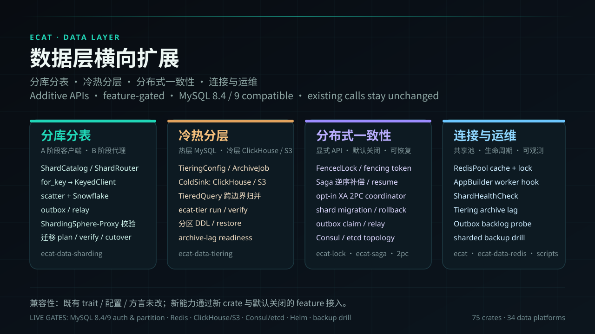

# Ecat data-layer scale-out

> Status: `7.2.0` (released). This page describes additive, default-off data-layer
> capabilities introduced in 7.2.0. Existing `SqlExecutor` / `RdbmsClient` / `Cache` / `Entity` /
> `Dialect` APIs and config fields are unchanged; new behavior ships in new crates and features.



## Capabilities and switches

| Capability | Crate | Feature / entry point | Default |
|---|---|---|---|
| Sharding, scatter, Snowflake, outbox, migration | `ecat-data-sharding` | `health` / `consul` / `etcd` / `migrate` | off |
| Hot/cold tiering, ClickHouse/S3 sinks, cross-boundary query, CLI | `ecat-data-tiering` | `clickhouse` / `s3` / `health` / `cli` | off |
| Saga engine | `ecat-saga` | standalone crate | opt-in |
| opt-in XA 2PC | `ecat-data-2pc` | `sqlx` (default on, MySQL/PostgreSQL only) | off in the facade (`2pc`) |
| Background worker lifecycle | `ecat` | `worker` | off |
| Shared Redis cache+lock pool | `ecat-data-redis` | always available | old constructors stay single-connection |

Facade features: `sharding` / `tiering` / `saga` / `"2pc"` / `worker`.
The target MySQL line is 8.4 LTS / 9.x; 8.0 support is compatibility-only.

## 1. Sharding

### 1.1 Topology

```yaml
sharding:
  mode: proxy            # proxy: ShardingSphere-Proxy routes; client: e-cat connects directly
  catalog:
    tables:
      - name: orders
        key: user_id
        pk: id
        algorithm:
          hash_mod: { shards: 4 }
        shards:
          - { name: s0 }
          - { name: s1 }
          - { name: s2 }
          - { name: s3 }
```

`proxy` forbids per-shard `url`; `client` requires one. The hash algorithm must match the
proxy configuration byte-for-byte; non-portable Java `hashCode` algorithms are not assumed
to agree. `ShardCatalog::validate` checks names, key/pk, shard count, duplicate endpoints,
and range boundaries.

### 1.2 Request-bound shards

```rust
let keyed = router.for_key("orders", &json!(42))?;
// all six methods stay on that shard
let rows = keyed.query("SELECT * FROM orders WHERE user_id = 42").await?;
let tx = keyed.transaction().await?;
```

No key means an error; there is no guessed default shard. Cross-shard reads use explicit
`scatter`:

```rust
let rows = router.scatter(&ScatterRequest {
    table: "orders".into(),
    sql: "SELECT * FROM orders WHERE status = ?".into(),
    params: vec![json!("paid")],
    order_by: "id".into(),
    limit: 100,
    offset: 0,
    timeout: Duration::from_secs(5),
    max_concurrency: 8,
}).await?;
```

Any shard failure or the total timeout fails the whole call; merge, primary-key dedupe, and
pagination happen in memory. `Snowflake` supplies global IDs; the outbox store and relay
provide idempotent cross-shard event delivery.

### 1.3 Migration / rebalance

```rust
let plan = ShardPlan::diff(&old_catalog, &new_catalog)?;
let migrator = ShardMigrator::new(plan, clients, state_db, old_catalog, new_catalog)?
    .with_chunk_size(1000);

migrator.backfill().await?;   // PK cursor, idempotent upsert, resumable
migrator.verify().await?;     // source/target rows + XOR checksum; mismatch blocks cutover
migrator.cutover(&router, new_catalog.clone()).await?;
// if needed:
migrator.rollback(&router).await?; // switch routing back; old shards are retained
```

- Hash changes copy the whole table and route each row through the new topology; range
  changes move key intervals.
- `shard_migration_jobs` stores phase/cursor/rows/checksum; `FencedLock` protects a single
  executor.
- Re-running after rollback re-enters backfill/verify instead of getting stuck.
- Phase B uses ShardingSphere-Scaling directly; this executor covers Phase A.

## 2. Hot/cold tiering

### 2.1 Config

```yaml
tiering:
  enabled: true
  hot_days: 180
  partition_months: 1
  batch_size: 1000
  verify_sample: 0.01
  tables:
    - name: events
      time_col: ts
      id_col: id
      retention_days: 365
      target: clickhouse   # or s3
```

The hot layer is MySQL (`RANGE COLUMNS` partitions); cold data goes to ClickHouse (queryable)
or S3/MinIO (restore/audit). Both sinks implement `ColdSink`:

```rust
pub trait ColdSink {
    async fn write_chunk(&self, table: &str, partition: &str, chunk: u64, rows: &[Row]) -> Result<String, TieringError>;
    async fn verify_chunk(&self, table: &str, partition: &str, chunk: u64, checksum: &str) -> Result<bool, TieringError>;
    async fn health_check(&self) -> Result<(), TieringError>;
}
```

### 2.2 Cross-boundary query

```rust
let query = TieredQuery::new(hot_db, cold_query, vec![TieredTable {
    name: "events".into(),
    time_col: "ts".into(),
    id_col: "id".into(),
    hot_days: 180,
}]);
let page = query.query_range("events", from, to, &[], 100, 0).await?;
```

All-hot queries go to MySQL; all-cold queries go to the cold layer. A boundary-crossing query
pushes `limit + offset` to both sides, merges by primary key, dedupes, and paginates.
`ClickhouseColdQuery` is the cold read adapter; `ClickhouseClient` has no parameter binding,
so the adapter only accepts SQL built from table metadata and time bounds and rejects
non-empty `params` instead of silently ignoring them.

### 2.3 CLI and readiness

```bash
# the config needs top-level database: and tiering:
ecat-tier plan   --config app.yaml
ecat-tier run    --config app.yaml --dry-run
ecat-tier verify --config app.yaml
# restore stays explicit: load cold data into staging, then call prepare_staging + restore_partition
ecat-tier restore --config app.yaml
```

`run` and `verify` require the `cli` feature. Cold-backend endpoints come from
`ECAT_CLICKHOUSE_URL` / `ECAT_CLICKHOUSE_DATABASE` and
`ECAT_S3_ENDPOINT` / `ECAT_S3_REGION` / `ECAT_S3_ACCESS_KEY` /
`ECAT_S3_SECRET_KEY` / `ECAT_S3_BUCKET` / `ECAT_S3_PREFIX`.

`TieringHealthCheck::with_archive_lag(store, max_lag)` checks the newest `updated_at` in the
state table in addition to cold reachability; no state rows means no archive history.
`probe_timeout` still bounds only the cold probe.

## 3. Distributed primitives

### 3.1 Fencing lock

```rust
let guard = lock.acquire_fenced("migration:orders", ttl).await?
    .ok_or_else(|| LockError::Other("another executor holds the lock".into()))?;
// resource side keeps max-seen and rejects smaller fences
assert!(lock.validate_fence("migration:orders", guard.fence).await?);
lock.release("migration:orders", &guard.token).await?;
```

A failed acquisition also increments the fence (monotonic). Migration exclusivity therefore
uses `renew` with the token; `validate_fence` is the resource-side max-seen check, not the
sole “am I still the holder?” test.

### 3.2 Saga

```rust
let saga = Saga::new(vec![step_a, step_b, step_c], store);
saga.run("order-42", ctx).await?;       // failure => reverse compensation; compensation failure => CompensationFailed
saga.resume("order-42").await?;         // resume from persisted current_step
```

Steps and compensations must be idempotent. `SagaContext` carries `idempotency_key`; state
lives in `saga_instances` / `saga_steps`. `Failed` is not retried automatically; it needs an
operator.

### 3.3 opt-in XA 2PC (MySQL/PostgreSQL only)

```rust
let coordinator = TwoPhaseCoordinator::new(coordinator_db, participants)
    .with_fence(lock, "2pc:recovery", Duration::from_secs(60));
let tx = coordinator.begin(&[("orders", orders_xa), ("stock", stock_xa)]).await?;
tx.execute("orders", "INSERT INTO orders ...", &[json!(42)]).await?;
tx.commit().await?;                      // END -> PREPARE all -> decision -> COMMIT all
```

- Coordination log: `distributed_tx(id, status, participants, decision, created_at)`.
- Any prepare failure rolls every participant back; recovery scans
  `prepared` / `committing` / `rolling_back`.
- The XA lifecycle is pinned to one physical connection. The coordinator DB is a single
  point; production needs external HA.
- 2PC is not wired into `KeyedClient` / `scatter`; it is an explicit API.

### 3.4 Shared Redis pool and remote topology

```rust
let cfg: RedisPoolConfig = serde_json::from_value(json!({
    "url": "redis://localhost:6379",
    "max_size": 16
}))?;
let pool = RedisPool::connect(cfg).await?;
let cache = pool.cache();   // shares Arc<Pool> with lock
let lock = pool.lock();
```

Old `connect` / `from_config` / `from_connection` constructors still use one multiplexed
connection. `ConsulTopologySource` / `EtcdTopologySource` provide `load/watch`; startup
without topology fails closed, and later bad JSON keeps the last known topology.

### 3.5 Background worker

```rust
App::builder()
    .background_worker(|mut shutdown| async move {
        archive_job.run_until(&mut shutdown).await.ok();
    })
    .build()?
    .run().await?;
```

`on_start` spawns the task; `on_stop` signals shutdown and waits for exit. The worker future
owns its own run budget.

## 4. MySQL 8.4 / 9 and compatibility

- Replication status uses `SHOW REPLICA STATUS`; 8.4/9 use `SHOW BINARY LOG STATUS` instead of
  the 8.0-only `SHOW MASTER STATUS`.
- Authentication uses `caching_sha2_password` only; 9.x removed `mysql_native_password`, and
  it must not be used to work around connection failures.
- `RANGE COLUMNS` syntax is unchanged; the first partition conversion still needs a real
  8.4/9 lock/algorithm check.
- Proxy auth, TLS, Helm/compose, real XA, cold stores, and the backup drill remain live gates;
  offline tests do not claim they passed.

## 5. Known limitations

- The migration executor moves scalar columns only; BLOB/BYTEA would be copied as base64 text
  and corrupted.
- Hash re-sharding is “backfill + caller-side dual write”; the executor has no dual-write hook.
- `rollback` only restores routing and keeps old shards; it does not copy data back.
- The 2PC coordinator DB is a single point; recovery does not cross-check participant
  `xa_recover`.
- `ecat-tier` cold backends are configured by environment variables; there is no ClickHouse
  auth environment pair yet.
- Archive-lag state queries are not bounded by `probe_timeout`.

## Related

- [Design](superpowers/specs/2026-10-24-data-layer-scaleout-design.md)
- [Implementation plan](superpowers/plans/2026-10-24-data-layer-scaleout.md)
- [API reference](api.md)
- [Database config tutorial](database-config-tutorial.md)
