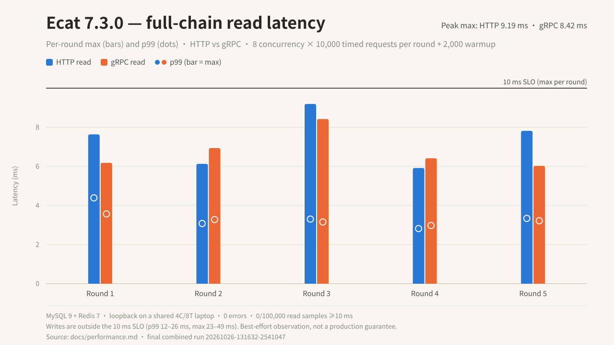

# Ecat performance benchmark (full chain)

> Version: 7.3.0. Status: 2026-10-26; performance commits `dcd8523` (harness) and `979d25f` (docs). Scope: local loopback, HTTP + gRPC + MySQL 9 + Redis 7; the read SLO is **max < 10ms per round**, writes are reported separately and are outside that SLO. These numbers are best-effort on a shared laptop, not a production guarantee.

## Summary

| Scenario | Final run | 5-round max | ≥10ms samples | Errors |
|---|---|---:|---:|---:|
| HTTP read (10k/round × 5) | `20261026-131632-2541047` | 5917–9193µs | 0 / 50,000 | 0 |
| gRPC read (10k/round × 5) | same combined run | 6026–8422µs | 0 / 50,000 | 0 |

- The final combined run loaded both transports at once; across read samples **0 / 100,000 ≥10ms**, gate passed. `env.txt` marks `noisy=true` only because peak temperature reached 91°C (loadavg 7.12, PSI IO avg10 16.69%).
- The read path is one primary-key `SELECT` plus one Redis `GET`. The earlier separate runs `20261026-123115` / `20261026-063056` are historical context only, no longer the primary data.
- The write path (`UPDATE` + Redis `SET`, including InnoDB durability) has p99 12–26ms and max 23–49ms; see "Write path". It is outside the 10ms read SLO.
- Middleware is opt-in and HTTP-only; the final middleware run did not pass the 10ms gate (14/15,000 ≥10ms); see "Middleware".



## Environment and topology

| Item | Value |
|---|---|
| Host | Intel i7-8550U, 4C/8T (`nproc=8`), governor `powersave` |
| Kernel / toolchain | 6.6.155; rustc/cargo 1.99.0; `RUSTFLAGS=-C target-cpu=native` |
| Runtime | `TOKIO_WORKER_THREADS=2` (server and load client) |
| CPU sets | server 0–1, client 2–3, MySQL 4, Redis 5 |
| Network | `127.0.0.1` loopback, no TLS/WAN; container ports published to `127.0.0.1` only |
| MySQL | `mysql:9`, `127.0.0.1:3307`, `--performance-schema=OFF --skip-name-resolve --innodb-buffer-pool-size=512M`; 10k seeded rows |
| Redis | `redis:7-alpine`, `127.0.0.1:6379`, `--save "" --appendonly no` (no persistence) |
| Containers | per-run `ecat-perf-mysql-$$` / `ecat-perf-redis-$$`; only containers created by this process are cleaned up |
| Build | release, dedicated target dir `/var/tmp/ecat-perf-target`, `cargo build --offline` |

`probe_timeout` is irrelevant here: it only bounds the tiering readiness cold probe and archive-lag query, and this benchmark does not enable tiering.

## Method

- Each round uses 8 concurrent workers and 10,000 measured requests; each round runs 2,000 warmup requests first, then all workers start timing at a Barrier. Five rounds per transport. The final run loads HTTP and gRPC in one `serve` process.
- Latency samples are client-side end-to-end times (connection reuse, protocol parsing, server processing). Each round reports p50 / p99 / p99.9 / max, the count of samples `>=10ms`, errors, and throughput.
- Server time is returned via the HTTP `x-server-us` header and the gRPC `server_us` field; the client records the round's maximum as `serverMaxµs`. The final harness only records requests with sequence >= warmup and clears the value each round. The HTTP `server_us` is stamped after JSON serialization while the gRPC value is stamped before tonic encoding, so they are not directly comparable at microsecond resolution.
- Each worker uses its own HTTP connection pool (`pool_max_idle_per_host=1`, `tcp_nodelay`) or its own gRPC Channel (`tcp_nodelay`), avoiding a shared pool lock and single-connection HTTP/2 multiplexing interference; static/read/write requests also rotate clients.
- Static baseline: HTTP `GET /static` (returns `OK`) and gRPC `Ping`, with no DB/Redis.
- Component probes: a separate process runs the same concurrency/request count/rounds against MySQL `SELECT` and Redis `GET`. The probes run sequentially and cannot be added to the full-chain number; they are for attribution only.
- The script gate validates expected series, round count, and per-round request/error counts; missing data, errors, or a read round `>= threshold` all fail (C1). `--middleware` forces `--transport http` because tonic has no equivalent middleware integration.
- `require_port_free` checks 3307/6379/8000/50051; containers use `$$` names and only successfully created containers are cleaned up (C2). Each run records loadavg, PSI, temperature, governor, commit, and dirty count in `env.txt`.

## Read path (final combined run)

`/var/tmp/ecat-perf-target/results/20261026-131632-2541047/`

### HTTP

| round | p50µs | p99µs | p99.9µs | maxµs | serverMaxµs | ≥10ms | err | qps |
|---:|---:|---:|---:|---:|---:|---:|---:|---:|
| 1 | 915 | 4389 | 6925 | 7637 | 7124 | 0 | 0 | 7290 |
| 2 | 894 | 3078 | 5043 | 6129 | 5079 | 0 | 0 | 7805 |
| 3 | 919 | 3302 | 7511 | 9193 | 6550 | 0 | 0 | 7466 |
| 4 | 909 | 2819 | 4943 | 5917 | 4936 | 0 | 0 | 7786 |
| 5 | 929 | 3339 | 5146 | 7818 | 5314 | 0 | 0 | 7331 |

### gRPC

| round | p50µs | p99µs | p99.9µs | maxµs | serverMaxµs | ≥10ms | err | qps |
|---:|---:|---:|---:|---:|---:|---:|---:|---:|
| 1 | 949 | 3567 | 4884 | 6180 | 4661 | 0 | 0 | 7251 |
| 2 | 966 | 3280 | 4678 | 6936 | 5709 | 0 | 0 | 7184 |
| 3 | 961 | 3154 | 5338 | 8422 | 6888 | 0 | 0 | 7290 |
| 4 | 965 | 2976 | 4859 | 6414 | 5271 | 0 | 0 | 7259 |
| 5 | 985 | 3218 | 5252 | 6026 | 5450 | 0 | 0 | 7160 |

Both transports had 0 errors and 0/50,000 ≥10ms, 0/100,000 combined; gate passed. The `noisy=true` marker is triggered only by the 91°C peak, and every read round stayed <10ms.

## Overhead attribution (same final run)

| Baseline/probe | p50µs | p99µs | maxµs |
|---|---:|---:|---:|
| HTTP static (no DB/Redis) | 218–235 | 461–595 | 973–4240 |
| gRPC static (Ping) | 213–224 | 424–475 | 622–3661 |
| MySQL probe (single `SELECT`) | 595–611 | 1692–1858 | 4002–13555 |
| Redis probe (single `GET`) | 104–120 | 241–268 | 1017–2473 |

- The static protocol baseline is about 0.21–0.24ms p50, not the dominant cost. The full-chain read p50 is 0.89–0.99ms, roughly 0.16–0.29ms above the sum of the MySQL and Redis probe p50s (0.70–0.73ms). The probes execute their two I/Os sequentially, so this is only rough attribution.
- The MySQL probe in the same final run still had 2/50,000 samples ≥10ms (max 13555µs) while the read series had 0; the probe and read rounds use different windows, so the probe tail must not be treated as the full-chain read tail.

## Write path (separate, outside the 10ms SLO)

`/var/tmp/ecat-perf-target/results/20261026-132004-2544813/`

| Transport | p50µs | p99µs | p99.9µs | maxµs | serverMaxµs | ≥10ms / 50,000 | qps |
|---|---:|---:|---:|---:|---:|---:|---:|
| HTTP write | 1102–7681 | 13287–26013 | 19536–34483 | 22645–48589 | unavailable | 3427 | 988–3018 |
| gRPC write | 1150–1311 | 12011–25382 | 18227–34261 | 24004–42979 | 23786–40609 | 1742 | 2635–3124 |

- HTTP round 1 has p50 7681µs and 1617/10000 samples ≥10ms; the other four rounds have p50 1102–1312µs and 317–546 over-threshold samples. The raw round is kept, not dropped.
- HTTP write `serverMaxµs` is 0 because the client in that run did not parse that response header; **this must not be read as zero server work**. HTTP write has no server-side attribution. The gRPC write `serverMax` shows the tail is dominated by server-side durability.
- Writes include the `UPDATE`, the Redis `SET`, and the default InnoDB flush/fsync. There were 0 errors, but this path does not promise 10ms. The run is marked `noisy=true` (load1 8.30 at classification, peak 97°C).

## Middleware (opt-in, HTTP only)

The baseline router is bare: the framework does not inject middleware. Only `--middleware` installs `MetricsLayer` + `TracingLayer` + `LoggingLayer` on the HTTP router and a synchronous fmt INFO stdout subscriber for `LoggingLayer`; the script forces HTTP (tonic has no equivalent middleware integration). Final run `/var/tmp/ecat-perf-target/results/20261026-132411-2551098/`: 8 concurrency, 5,000/round, 1,000 warmup, 3 rounds.

| round | p50µs | p99µs | p99.9µs | maxµs | serverMaxµs | ≥10ms | err | qps |
|---:|---:|---:|---:|---:|---:|---:|---:|---:|
| 1 | 1578 | 5288 | 7147 | 8400 | 6490 | 0 | 0 | 4322 |
| 2 | 1586 | 7618 | 10766 | 11579 | 6895 | 10 | 0 | 3867 |
| 3 | 1512 | 5119 | 7791 | 12085 | 6305 | 4 | 0 | 4576 |

- **14/15,000 samples ≥10ms, gate FAILED**; `noisy=true` (load1 8.03 at classification, peak 98°C), and `server.log` is about 19.7MB, consistent with synchronous per-request logging.
- Handler-reported `serverMax` topped out at 6895µs (<10ms); the >10ms samples are client-observed and include middleware and log writes outside the handler timer.
- Conclusion: opt-in Metrics + Tracing + Logging with **synchronous fmt stdout per-request logging** did not meet max<10ms. Earlier middleware runs once had 0 over-threshold samples, but the windows and sample counts differ, so that is not a controlled comparison; the bare baseline (no middleware) is the 10ms dataset. For a p100 10ms target, use non-blocking/sampled logging or omit `LoggingLayer`.

## TCP_NODELAY

Changes (all server-side):

- `ecat-transport-http`: `axum::serve` does not set `TCP_NODELAY` automatically. The plaintext listener sets it per connection via `ListenerExt::tap_io`, and the TLS accept loop sets it too.
- `ecat-transport-grpc`: tonic's `Server` defaults to `tcp_nodelay=false`; it is now `Server::builder().tcp_nodelay(true)`. The tonic client `Endpoint` already defaults to on.

Before/after smoke runs (raw artifacts, not a controlled A/B; other builds ran concurrently, loadavg about 18→3.7):

| Stage | run | Config | HTTP read maxµs (≥10ms/requests) | gRPC read maxµs (≥10ms/requests) |
|---|---|---|---:|---:|
| Before HTTP change (gRPC also unchanged) | 060617 | 2000×1 | 29625 (71/2000) | 11648 (8/2000) |
| After HTTP change | 061005/061321/061558 | 2000×1 | 5392–15466 (0–42/2000) | 4257–8393 (0/2000) |
| Before gRPC change | 062208 | 10000×5 | — | 8742–11268 (6/50000) |
| After gRPC change | 062536 | 10000×5 | — | 6216–10851 (1/50000) |
| After both (clean) | 063056 | 10000×5 | — | 5613–7310 (0/50000) |

- Before/after attribution maps source-file mtime to run start time; `env.txt` records only the commit and dirty count, so the artifact alone cannot identify the version.
- Early smoke static/`serverMax` numbers are affected by old client defects (no client rotation, warmup samples counted in `serverMax`); the final harness fixes both. All primary data in this document comes from the final runs. The TLS branch sets the same option, but there is no TLS performance data.

## Noise and variability

- The final read run `131632` is marked `noisy=true` only because of the 91°C peak, and its read gate still passed; the final middleware run `132411` had load1 8.03 plus 98°C, 14/15,000 over-threshold samples, and failed the gate.
- Historical noisy samples: `122711` HTTP read round 3 max 13201µs (14/10000 over); `124538` gRPC read max 21050µs (178/10000 in round 1), HTTP read max 25837µs (18 over); `123439` gRPC read round 3 max 57052µs (102 over).
- Observed that day: loadavg up to about 18, PSI IO avg10 up to about 77.5%, and 97–98°C. All noisy runs are retained rather than silently discarded; `max`/p100 cannot be guaranteed on a shared machine, and the results are not a production promise.

## Reproduce

```bash
# Default: concurrency 8, 10k/round, 2k warmup, 5 rounds,
# HTTP+gRPC, read+write+static
bash scripts/perf/fullchain.sh

# Read only; middleware (HTTP only)
bash scripts/perf/fullchain.sh --op read
bash scripts/perf/fullchain.sh --middleware

# Options
#   --rounds N  --concurrency N  --total N  --warmup N  --threshold-us N
#   --transport both|http|grpc   --op both|read|write|static
#   --middleware   --skip-build   --keep
```

- Requires the cached `mysql:9` and `redis:7-alpine` images; no network is needed beyond them. Startup is refused if ports 3307/6379/8000/50051 are occupied; container ports are bound to `127.0.0.1`.
- Default target dir is `/var/tmp/ecat-perf-target` (override with `ECAT_PERF_TARGET`). Artifacts land in `results/<timestamp>-<pid>/`: `env.txt`, `<transport>-<op>.jsonl`, `probe-*.jsonl`, and `summary.md`.
- The gate checks expected series, round count, per-round request count, and errors; missing data or any read round `>= threshold` fails.
- Suggested window: load1 < `nproc`, PSI IO avg10 < 25%, peak temperature < 85°C. On completion the script appends a `noisy=` marker to `env.txt` using those thresholds.

## Known limitations

- Only MySQL 9 + Redis 7 (2 of the 19 backends listed in the README); the other 17 backends and the sharding, tiering, Saga, and 2PC data-layer capabilities are not covered.
- Loopback only: no TLS, no real WAN RTT, no cross-host network or load balancer. The TLS listener sets `TCP_NODELAY`, but no TLS performance data was collected.
- Only read, write, and static operations; no cold start, connection storm, long-running/memory, or fault-injection tests.
- The write path includes the InnoDB flush/fsync, and HTTP write has no server-side attribution; it does not promise 10ms.
- Middleware covers HTTP only, and synchronous fmt stdout logging did not meet max<10ms; this says nothing about gRPC middleware or non-blocking logging.
- Single 4C/8T machine with the `powersave` governor and shared build load; `max`/p100 cannot be guaranteed and the results do not extrapolate to production.
